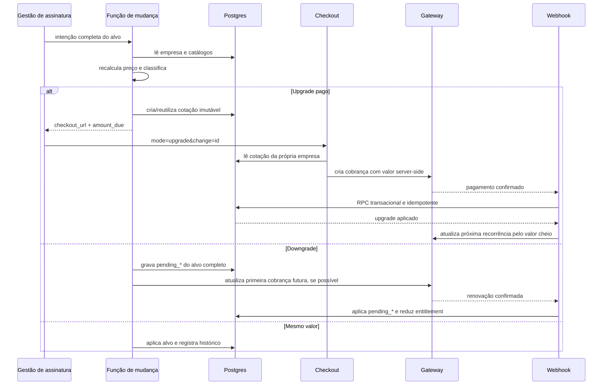
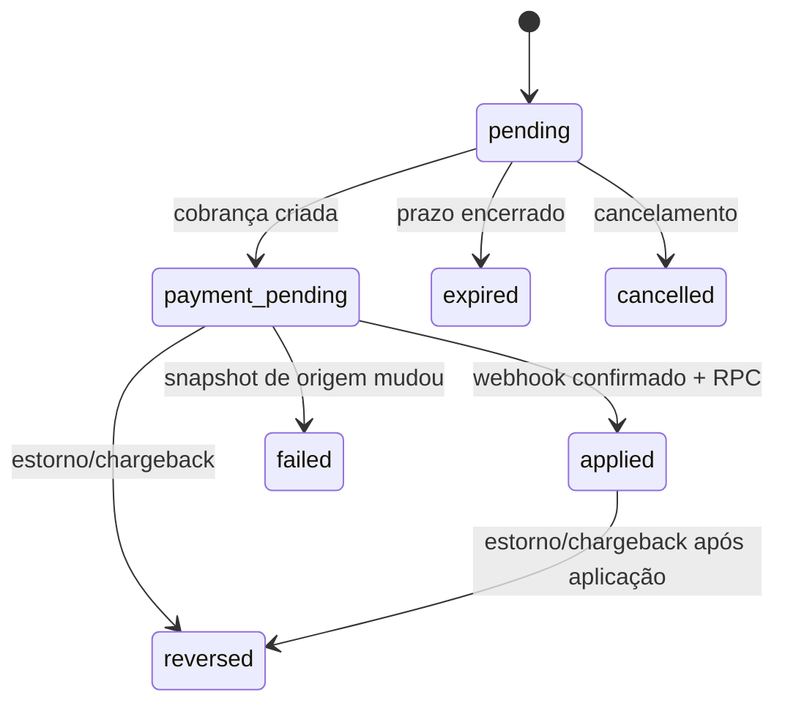

# Handoff — Pro-rata e gestão segura de assinaturas no Ecosistema

## 1. Objetivo

Aplicar no repositório do **Ecosistema** a política de mudança de assinatura validada na Dominex, cobrindo:

- upgrade e downgrade de plano;
- contratação e remoção de um ou vários módulos de uma vez;
- usuários adicionais;
- aumento e redução de níveis/cotas de Nota Fiscal;
- outros add-ons por nível, se existirem no Ecosistema;
- ciclos mensal e anual;
- checkout reutilizado para venda, renovação e upgrade;
- cobrança imediata do pro-rata no cartão já cadastrado, mediante confirmação explícita;
- confirmação via webhook antes de liberar qualquer benefício pago;
- atualização da próxima recorrência pelo valor integral do novo conjunto;
- proteção contra subpagamento, replay, troca entre empresas e uso temporário sem pagar.

Este documento é uma especificação técnica e de produto. Os nomes de tabelas e campos devem ser mapeados para o schema real do Ecosistema antes da implementação. Não copiar migrations ou funções sem conferir constraints, RLS, tipos e integrações existentes.

### Referência validada

- Repositório de origem: Dominex Tecnologia.
- Versão funcional: `1.31.5`.
- Commit da implementação: `5cc38551b158ffda025c7ac5abc4839510269cd2`.
- Commit do ajuste de versão: `c560e3a7b8f797edc8f6dfac94615929f7217bdc`.
- Extensão de cartão salvo: incluída na release `1.31.5`, além dos commits-base de pro-rata listados acima.
- Gateway usado na referência: Asaas.
- Backend usado na referência: Supabase/Postgres + Edge Functions.

---

## 2. Política de negócio aprovada

### Upgrade

Quando o valor mensal equivalente do conjunto desejado for maior que o valor efetivo atual:

1. O servidor calcula a diferença proporcional até o próximo vencimento.
2. O checkout cobra essa diferença imediatamente.
3. Plano, módulos, usuários e cotas adicionais **não são liberados antes da confirmação do pagamento**.
4. O webhook confirmado aplica todos os benefícios em uma única operação transacional.
5. A recorrência futura passa a cobrar o valor integral do novo conjunto.
6. Se a assinatura atual usa cartão e existe token reutilizável, esse cartão aparece como opção principal: o cliente confirma “Pagar R$ X agora” e a cobrança é tentada imediatamente.

O cartão salvo **não pode ser cobrado ao abrir a tela**. A ação exige clique explícito, apresenta o valor exato, a bandeira e somente os quatro últimos dígitos. Pix, boleto e outro cartão continuam disponíveis como alternativas.

Exemplo mensal:

- assinatura atual: R$ 200/mês;
- novo conjunto: R$ 500/mês;
- metade do ciclo restante;
- cobrança agora: `(500 - 200) × 0,5 = R$ 150`;
- próxima renovação: R$ 500.

### Downgrade

Quando o valor mensal equivalente do conjunto desejado for menor que o valor efetivo atual:

1. Nenhum reembolso ou crédito sacável é concedido.
2. O cliente mantém tudo que já pagou até o fim do ciclo atual.
3. O alvo completo fica agendado: plano, ciclo, módulos, usuários, nível fiscal e demais add-ons.
4. A primeira cobrança seguinte já usa o valor reduzido.
5. Os benefícios são reduzidos somente depois que essa renovação for confirmada.

### Mudança sem diferença de preço

Se o valor final permanecer igual, a troca pode ser aplicada sem cobrança adicional. Ela deve continuar passando pelo servidor e pelo controle de autorização. Registrar a troca no histórico.

### Vários itens na mesma alteração

A classificação é feita pelo **valor final líquido do conjunto**, não item por item:

- adicionar três módulos de uma vez gera uma única cotação;
- adicionar um módulo e remover outro compara o total anterior com o total desejado;
- total maior: upgrade proporcional;
- total menor: downgrade agendado;
- total igual: troca sem cobrança.

### Contratação de módulo por atalho

O botão “Contratar módulo” deve abrir o mesmo gerenciador de assinatura, com o módulo pré-selecionado. Não deve existir um caminho alternativo que libere o módulo diretamente.

### Regra antifraude principal

O cliente nunca pode:

- ativar um módulo e removê-lo antes da renovação sem pagar pelo período usado;
- elevar uma cota fiscal antes do pagamento;
- enviar um preço menor pelo navegador;
- reutilizar uma cobrança antiga com preço inferior;
- aplicar uma cotação de outra empresa;
- estender o vencimento apenas pela confirmação visual do checkout.

---

## 3. Invariantes não negociáveis

1. **Preço vem do servidor.** O cliente envia somente a intenção: plano, módulos, usuários, ciclo e níveis desejados.
2. **Entitlement vem do pagamento persistido.** Tela de sucesso do gateway não concede acesso.
3. **Webhook confirmado é a autoridade.** Ele chama uma operação transacional e idempotente.
4. **Cotação é um snapshot imutável.** Guarda origem, alvo, período, crédito, valor devido e vencimento.
5. **Snapshot desatualizado falha fechado.** Se a assinatura mudou depois da cotação, registrar o pagamento e exigir conciliação; não liberar um alvo potencialmente incorreto.
6. **Downgrade não antecipa perda de acesso.** O cliente conserva o ciclo pago.
7. **Primeira renovação após downgrade já usa o preço reduzido.** Não cobrar o valor antigo para reduzir somente depois.
8. **Toda escrita privilegiada valida autenticação, empresa e papel.** `service_role` não substitui autorização de negócio.
9. **RLS é defesa real.** O tenant pode ler a própria cotação, mas não criar, alterar ou aplicar cotações diretamente.
10. **Indisponibilidade e estado desconhecido falham fechado.** Não presumir pagamento, módulo, nível ou valor.
11. **Token de cartão nunca chega ao browser nem fica em tabela pública.** Guardar em cofre/Vault e ler somente em função privilegiada.
12. **Cartão salvo exige confirmação explícita.** O checkout pode torná-lo a ação padrão, mas nunca disparar cobrança em `useEffect`, montagem ou carregamento da página.

---

## 4. Descoberta obrigatória no Ecosistema

Antes de editar, mapear e registrar no PR/handoff final:

| Conceito | Identificar no Ecosistema |
|---|---|
| Empresa/tenant | tabela, PK e função que resolve a empresa do usuário |
| Assinatura | status, vencimento, plano, ciclo e valor atual |
| Promoção | preço promocional, duração e pagamentos já consumidos |
| Planos | catálogo, preço mensal, módulos inclusos e usuários inclusos |
| Módulos | catálogo, preço, status ativo e tabela de vínculo empresa–módulo |
| Usuários extras | preço unitário e limite máximo |
| Nota Fiscal | módulo necessário, tabela de níveis, preço e cota de cada nível |
| Recorrência | ID da assinatura/autorização no gateway |
| Pagamentos | tabela local, chave idempotente e vínculo com empresa |
| Histórico | tabela de auditoria de assinatura |
| Financeiro interno | LTV, receitas, tarifas e transações administrativas |
| Autorização | helper para própria empresa e super admin |
| Renovação | função/webhook que avança o vencimento e aplica pendências |
| Estorno | fluxo atual de refund/chargeback |
| Checkout | rotas e hooks usados em venda e renovação |

Não assumir que `subscription_value` representa sempre o valor efetivo. Se houver promoção ativa, o cálculo deve usar o valor realmente vigente no ciclo.

---

## 5. Modelo de cálculo

### 5.1 Valores do período

Na referência Dominex:

```ts
periodValue(monthlyValue, "monthly") = round(monthlyValue)
periodValue(monthlyValue, "yearly")  = round(monthlyValue * 12 * 0.8)
```

O fator `0.8` representa 20% de desconto anual. No Ecosistema, esse fator deve vir da política/catálogo real. Não duplicar percentuais no frontend e backend.

### 5.2 Proporção restante

Usar tempo real do ciclo, inclusive meses com 28, 29, 30 ou 31 dias:

```text
periodStart     = periodEnd deslocado um ciclo para trás
periodDuration  = periodEnd - periodStart
remaining       = max(0, periodEnd - now)
remainingRatio  = clamp(remaining / periodDuration, 0, 1)
```

Datas no último dia do mês precisam ser limitadas ao último dia do mês de destino. Exemplo: um ciclo encerrado em 31/03 começa em 28/02 ou 29/02, não em uma data transbordada para março.

### 5.3 Mensal → mensal e anual → anual

```text
sourcePeriodValue = preço do período atual
targetPeriodValue = preço do período alvo
creditAmount      = sourcePeriodValue × remainingRatio
amountDue         = (targetPeriodValue - sourcePeriodValue) × remainingRatio
```

Manter o vencimento atual.

### 5.4 Mensal → anual

É um novo compromisso anual:

```text
creditAmount = valor mensal atual × remainingRatio
amountDue    = valor anual alvo - creditAmount
```

- cobrar à vista conforme a política aprovada;
- na referência, Pix ou boleto;
- reiniciar a âncora: próximo vencimento = agora + 1 ano;
- não permitir que o cliente force cartão mensal para obter o desconto anual.

### 5.5 Anual → mensal

Tratar como downgrade agendado, mesmo quando o preço mensal nominal do alvo for maior. Não quebrar um compromisso anual no meio do ciclo.

### 5.6 Arredondamento

- arredondar valores monetários para duas casas;
- tolerância de conciliação recomendada: R$ 0,02;
- nunca usar o valor do frontend como fonte da cobrança;
- registrar `remaining_ratio` com precisão suficiente, por exemplo `NUMERIC(10,8)`.

### 5.7 Piso do gateway

Na Dominex, ajustes inferiores a R$ 5 podem ser concedidos como cortesia porque ficam abaixo do piso operacional adotado. No Ecosistema, decidir explicitamente:

- valor mínimo real aceito pelo gateway;
- se a diferença será cortesia;
- se será acumulada para a próxima fatura;
- como será auditada.

Não deixar o comportamento implícito. A cortesia deve ser uma exceção pequena e controlada, não um caminho para fracionar upgrades.

---

## 6. Arquitetura do fluxo



### Máquina de estados da cotação



Estados terminais não podem voltar a ser pagáveis sem uma nova cotação.

---

## 7. Banco de dados

### 7.1 Nova tabela de cotações

Criar uma tabela equivalente a `subscription_change_requests` com:

```text
id                         uuid PK
company_id                 uuid FK tenant NOT NULL
requested_by               uuid FK auth user NULL
change_kind                text CHECK upgrade
status                     text CHECK pending/payment_pending/applied/expired/cancelled/failed/reversed

source_plan_code           text NULL
target_plan_code           text NOT NULL
target_label               text NULL
source_billing_cycle       text CHECK monthly/yearly
target_billing_cycle       text CHECK monthly/yearly

source_subscription_value  numeric(14,2) NOT NULL
source_monthly_value       numeric(14,2) NOT NULL
target_monthly_value       numeric(14,2) NOT NULL
source_period_value        numeric(14,2) NOT NULL
target_period_value        numeric(14,2) NOT NULL
credit_amount              numeric(14,2) NOT NULL
amount_due                 numeric(14,2) CHECK > 0
remaining_ratio            numeric(10,8) CHECK 0..1

period_started_at          timestamptz NOT NULL
period_ends_at             timestamptz NOT NULL
next_renewal_at            timestamptz NOT NULL
resets_billing_anchor      boolean NOT NULL

target_modules             text[] NOT NULL
target_max_users           integer CHECK > 0
target_extra_users         integer CHECK >= 0
source_nfse_tier           smallint NULL
target_nfse_tier           smallint NULL
source_whatsapp_tier       smallint NULL
target_whatsapp_tier       smallint NULL

request_fingerprint        text NOT NULL
gateway_payment_id         text NULL
paid_at                    timestamptz NULL
applied_at                 timestamptz NULL
expires_at                 timestamptz NOT NULL
created_at                 timestamptz NOT NULL
updated_at                 timestamptz NOT NULL
```

Se o Ecosistema não tiver WhatsApp ou tiver outros add-ons, substituir pelos entitlements reais. Para muitos tipos de add-on, considerar `source_entitlements jsonb` e `target_entitlements jsonb`, mas validar estrutura e versão antes de aplicar.

### 7.2 Índices e idempotência

Criar:

- índice por `(company_id, created_at desc)`;
- índice único parcial por `(company_id, request_fingerprint)` enquanto o status for `pending` ou `payment_pending`;
- índice único por `gateway_payment_id` quando não nulo;
- FK do pagamento local para a cotação.

O fingerprint precisa incluir tudo que muda o preço ou entitlement:

```text
escopo + plano origem + plano alvo + ciclo origem + ciclo alvo +
valor origem + valor alvo + usuários + níveis + módulos ordenados +
vencimento da assinatura
```

### 7.3 Campos pendentes na empresa

O alvo de downgrade precisa sobreviver até a renovação. Ter equivalentes para:

```text
pending_subscription_value
pending_plan_code
pending_billing_cycle
pending_modules
pending_max_users
pending_nfse_tier
pending_whatsapp_tier ou outros add-ons
```

Não usar apenas texto em histórico como fonte do downgrade. Histórico é auditoria; `pending_*` é estado operacional.

### 7.4 RLS

Política recomendada:

- `SELECT`: super admin ou usuário da mesma empresa;
- `INSERT/UPDATE/DELETE`: nenhuma policy para `authenticated` ou `anon`;
- escritas somente pelas funções privilegiadas;
- RPC de aplicação revogada de `PUBLIC`, `anon` e `authenticated`;
- `EXECUTE` concedido somente a `service_role`.

Adicionar teste SQL que confirme:

- RLS habilitada;
- tenant A não lê cotação do tenant B;
- tenant não cria nem altera cotação;
- usuário autenticado não executa a RPC;
- `service_role` executa a RPC.

### 7.5 RPC transacional de aplicação

Criar uma função equivalente a `apply_subscription_upgrade_payment`.

Dentro de uma única transação:

1. Bloquear a cotação com `FOR UPDATE`.
2. Retornar idempotentemente se já estiver `applied`.
3. Aceitar somente `pending` ou `payment_pending`.
4. Conferir valor pago contra `amount_due`, com tolerância de centavos.
5. Conferir se o payment ID já vinculado é o mesmo.
6. Bloquear a empresa com `FOR UPDATE`.
7. Revalidar snapshot de origem: plano, ciclo, valor contratual, valor efetivo/promocional e níveis relevantes.
8. Se a origem mudou, marcar `failed`, persistir o pagamento e emitir necessidade de conciliação; não aplicar entitlement.
9. Atualizar empresa com o alvo completo.
10. Substituir módulos da empresa pelos módulos-alvo.
11. Encerrar promoção incompatível com o upgrade, conforme política.
12. Limpar pendências anteriores que ficaram obsoletas.
13. Registrar histórico, receita, pagamento e LTV idempotentemente.
14. Marcar cotação como `applied`, com `paid_at`, `applied_at` e payment ID.

A RPC deve retornar pelo menos:

```json
{
  "applied": true,
  "already_applied": false,
  "company_id": "...",
  "target_monthly_value": 500,
  "target_period_value": 4800,
  "target_billing_cycle": "yearly",
  "next_renewal_at": "..."
}
```

---

## 8. Backend: mudança unificada da assinatura

Criar ou adaptar uma função única para a tela de gestão da assinatura.

### Entrada sugerida

```ts
interface ChangeSubscriptionRequest {
  company_id: string;
  plan_code: string;
  billing_cycle?: "monthly" | "yearly";
  custom_modules?: string[];
  extra_users?: number;
  nfse_tier?: number;
  // incluir outros níveis do Ecosistema
}
```

### Etapas obrigatórias

1. Validar JWT.
2. Autorizar própria empresa ou super admin.
3. Ler empresa e assinatura atuais.
4. Ler catálogo ativo de planos, módulos, usuários e níveis.
5. Ignorar preços enviados pelo cliente.
6. Normalizar módulos obrigatórios e remover códigos inexistentes.
7. Calcular usuários dentro dos limites permitidos.
8. Calcular o valor mensal alvo completo.
9. Resolver o valor efetivo atual, incluindo promoção ativa.
10. Classificar como upgrade, downgrade ou igual.
11. Executar apenas o ramo correspondente.

### Upgrade

- gerar cotação de 48 horas ou prazo equivalente;
- reutilizar cotação ativa com o mesmo fingerprint;
- expirar cotação vencida antes de criar outra;
- responder com `requires_payment`, ID, URL, valor, crédito e próxima renovação;
- não tocar no entitlement antes do webhook.

Resposta:

```json
{
  "success": true,
  "change_kind": "upgrade",
  "requires_payment": true,
  "change_request_id": "uuid",
  "checkout_url": "/checkout?mode=upgrade&change=uuid",
  "amount_due": 150,
  "credit_amount": 100,
  "remaining_ratio": 0.5,
  "next_renewal_at": "..."
}
```

### Downgrade

- gravar o alvo completo em `pending_*`;
- manter plano, módulos, usuários e cotas atuais;
- atualizar a recorrência futura no gateway quando suportado;
- usar `updatePendingPayments: true` ou equivalente para corrigir fatura futura já materializada;
- se o ID salvo for autorização de Pix Automático, resolver a assinatura associada antes de atualizar;
- falha de sincronização do gateway deve gerar alerta operacional, sem apagar o downgrade local.

### Mesmo valor

- aplicar o alvo diretamente pelo backend;
- registrar histórico;
- limpar pendências incompatíveis;
- sincronizar recorrência se necessário.

### Super admin

Uma concessão manual pode ter política diferente, mas precisa ser explícita, autorizada no servidor e auditada. Não permitir que a UI do tenant acione o caminho administrativo.

---

## 9. Níveis de Nota Fiscal

### Pré-requisitos

- a empresa precisa possuir o módulo fiscal;
- nível atual e destino precisam existir no catálogo ativo;
- o preço vem da tabela de níveis;
- alterar nível não pode ser usado para contratar o módulo fiscal implicitamente.

### Upgrade de nível

```text
delta = preço(nível alvo) - preço(nível atual)
novo valor mensal = valor da assinatura + delta
```

Para tenant ativo:

1. Criar a mesma cotação proporcional usada por plano/módulos.
2. Incluir `source_nfse_tier` e `target_nfse_tier` no snapshot.
3. Direcionar para o mesmo checkout.
4. Liberar a nova cota somente pelo webhook.

### Downgrade de nível

Não reduzir imediatamente pelo card de nível. Encaminhar para o gerenciador completo de assinatura, gravar `pending_nfse_tier` e aplicar na próxima renovação confirmada.

### Contratação do módulo fiscal

Se o módulo ainda não estiver ativo, o CTA precisa abrir a gestão da assinatura com o módulo fiscal pré-selecionado. O preço do nível inicial deve entrar no alvo conforme o catálogo do Ecosistema.

### Outros níveis/add-ons

Aplicar a mesma estrutura para WhatsApp, documentos, armazenamento ou qualquer cota paga:

- módulo como pré-requisito;
- catálogo server-side;
- upgrade proporcional;
- downgrade agendado;
- snapshot de origem e destino;
- entitlement após pagamento.

---

## 10. Criação da cobrança

Adaptar a função que cria pagamentos para aceitar:

```ts
purpose?: "sale" | "renewal" | "upgrade";
change_request_id?: string;
```

No modo `upgrade`:

1. Buscar cotação por `id` **e** `company_id`.
2. Validar status pagável.
3. Validar expiração.
4. Reconciliar o valor solicitado com `amount_due` da cotação.
5. Impedir cartão quando a política anual à vista exigir Pix/boleto.
6. Somente depois da reconciliação procurar cobrança pendente reutilizável.
7. Reutilizar apenas se empresa, valor, tipo, finalidade e cotação coincidirem.
8. Criar cobrança avulsa com referência externa inequívoca, por exemplo:

```text
upgrade:{change_request_id}:{company_id}
```

9. Persistir a cobrança local vinculada à cotação.
10. Atualizar a cotação para `payment_pending` com o payment ID.

Nunca reaproveitar uma cobrança pendente antes de recalcular o preço no servidor. Essa ordem fecha a possibilidade de selecionar algo mais caro e pagar uma cobrança antiga mais barata.

Para renovação após downgrade, o valor esperado precisa priorizar `pending_subscription_value`, e o checkout deve usar também plano, ciclo, módulos e limite pendentes.

---

## 11. Webhook do gateway

### Ordem de roteamento

Ao receber confirmação:

1. Tentar resolver primeiro se o pagamento pertence a uma cotação de upgrade.
2. Se for upgrade, processar pela RPC específica.
3. Só depois seguir para venda/renovação comum.

Isso evita que uma cobrança proporcional seja confundida com renovação e avance o vencimento incorretamente.

### Resolução da cotação

Resolver por:

- referência externa `upgrade:{request_id}:{company_id}`; ou
- vínculo persistido no pagamento local.

### Após aplicar o upgrade

- atualizar a recorrência futura com o valor integral do alvo;
- atualizar ciclo e próximo vencimento quando aplicável;
- usar atualização de pagamentos pendentes quando necessário;
- registrar tarifa do gateway separadamente;
- emitir alerta se o entitlement foi aplicado, mas a recorrência não sincronizou.

### Pagamento com snapshot divergente

Se o cliente pagou, mas a assinatura de origem mudou:

- persistir o pagamento;
- marcar a cotação como `failed`;
- não aplicar o alvo automaticamente;
- criar alerta administrativo de conciliação;
- não perder o evento nem responder como se tudo estivesse liberado.

### Idempotência

Webhooks repetidos precisam retornar sucesso operacional sem duplicar:

- LTV;
- receita interna;
- histórico;
- módulos;
- avanço de vencimento;
- aplicação da cotação.

---

## 12. Renovação e aplicação de downgrade

No webhook de renovação confirmada:

1. Atualizar de forma vital e fatal apenas `subscription_status=active` e novo vencimento.
2. Aplicar extras em etapa separada para uma constraint inválida não retirar o acesso de quem pagou.
3. Se houver `pending_subscription_value`, torná-lo o valor atual.
4. Se houver `pending_plan_code`, aplicar plano, ciclo, módulos, usuários e níveis pendentes.
5. Sincronizar a tabela de módulos.
6. Limpar `pending_*` somente depois de a aplicação correspondente funcionar.
7. Registrar histórico do downgrade efetivado.

Se a etapa de extras falhar, manter as pendências para nova tentativa e alertar a operação. Não limpar silenciosamente.

---

## 13. Estorno e chargeback

Upgrade proporcional não é uma renovação completa. Portanto, um estorno desse pagamento não deve desativar automaticamente toda a assinatura como se o ciclo inteiro tivesse sido devolvido.

Ao receber estorno/chargeback:

- marcar a cotação como `reversed`;
- atualizar o pagamento local;
- devolver mutex/idempotência financeira quando aplicável;
- gerar alerta administrativo;
- decidir explicitamente se os benefícios adicionados serão revertidos automaticamente ou conciliados manualmente;
- nunca reduzir abaixo do conjunto que já estava pago antes do upgrade.

Se implementar reversão automática, guardar também o snapshot completo de origem de módulos, usuários e níveis. A referência Dominex optou por alerta e revisão para evitar destruir entitlement legítimo.

---

## 14. Frontend e UX

### Gestão da assinatura

Uma única tela/modal deve permitir:

- escolher plano pronto ou personalizado;
- adicionar/remover vários módulos;
- adicionar/remover usuários extras;
- escolher nível fiscal quando o módulo estiver selecionado;
- trocar ciclo mensal/anual;
- ver o valor mensal equivalente do alvo;
- ver se a mudança é upgrade ou downgrade.

Ao confirmar, enviar apenas a intenção completa. O valor exibido é estimativa; a resposta do servidor decide o fluxo.

### Comportamentos

- `requires_payment=true`: navegar para `checkout_url`;
- downgrade: fechar modal e mostrar data/valor da próxima cobrança;
- igual: atualizar consultas e mostrar confirmação;
- erro de catálogo: bloquear confirmação;
- excesso de usuários em downgrade: exigir redução antes de agendar.

### Checkout reutilizado

Rota sugerida:

```text
/checkout?mode=upgrade&change={request_id}
```

No modo upgrade:

- ocultar seleção de plano;
- carregar a cotação do servidor;
- conferir que pertence à empresa logada;
- mostrar plano/configuração atual e alvo;
- mostrar “Cobrança proporcional hoje”;
- mostrar crédito do período já pago;
- mostrar próxima renovação e valor integral;
- listar módulos e usuários do alvo;
- explicar que a liberação ocorre após confirmação;
- tratar cotação expirada, cancelada, aplicada, falha e estornada;
- aguardar status `applied` antes de anunciar sucesso.

Copy mínima recomendada:

```text
Você paga agora somente a diferença correspondente ao período restante.
Os novos recursos serão liberados após a confirmação do pagamento.
Na próxima renovação, será cobrado o valor integral da nova assinatura.
```

Para downgrade:

```text
Você mantém sua configuração atual até o fim do período já pago.
O novo valor e os novos limites passam a valer na próxima renovação.
Não há reembolso do ciclo atual.
```

### Recorrência padrão por meio de pagamento

- No checkout comum de venda/renovação, **Pix Automático nasce ativado por padrão**. O primeiro payload já solicita a autorização recorrente; o toggle não pode parecer ligado enquanto cria um Pix avulso por trás.
- No checkout comum de venda/renovação, **cartão cria assinatura recorrente mensal por padrão**, com a primeira cobrança processada imediatamente.
- No upgrade, Pix, boleto ou cartão cobram somente o pro-rata como pagamento avulso. Após a confirmação, o webhook aplica os novos entitlements e atualiza o valor da recorrência existente para a próxima renovação.
- Um upgrade nunca deve criar uma segunda recorrência. Se não houver recorrência atualizável, persistir alerta operacional e conciliar sem liberar por mera resposta visual do gateway.

### Cartão cadastrado como padrão no upgrade

Quando a assinatura vigente estiver em cartão e houver token reutilizável válido:

1. Mostrar primeiro um card com `Bandeira •••• 1234` e o selo “Cartão cadastrado”.
2. Exibir como CTA principal `Pagar R$ {amount_due} agora`.
3. Informar que o débito do pro-rata acontece ao confirmar e que a próxima renovação virá pelo valor integral atualizado.
4. Disponibilizar `Escolher outra forma de pagamento` para Pix, boleto ou novo cartão.
5. No clique, enviar apenas `use_saved_card: true`, `change_request_id` e a intenção de pagamento; nunca enviar token ao cliente.
6. Manter estados de processamento, recusa, erro recuperável e tentativa por outro meio.

O backend só aceita `use_saved_card` quando todas as condições forem verdadeiras:

- `purpose = upgrade`;
- `billing_type = CREDIT_CARD`;
- a cotação pertence à empresa autenticada e continua pagável;
- a recorrência atual da empresa ainda é de cartão;
- existe token da mesma empresa no Vault;
- o gateway recebe `remoteIp` e o token lido server-side.

Cartões antigos que nunca foram tokenizados não podem ser recuperados a partir de uma assinatura já existente. Nesses casos, manter o formulário atual. Na próxima digitação do cartão, tokenizar e salvar para upgrades futuros, sem bloquear a cobrança presente se a conta do gateway ainda não estiver habilitada para tokenização.

### Armazenamento seguro do cartão

- Guardar o token do gateway no Supabase Vault, cofre equivalente ou provedor PCI; nunca em `companies`, `profiles`, local storage, analytics ou logs.
- Usar um nome determinístico por empresa e RPCs wrapper que recebem `company_id`, sem permitir ao caller escolher o nome de outro segredo.
- Revogar execução das RPCs para `PUBLIC`, `anon` e `authenticated`; conceder somente à `service_role`.
- Guardar na empresa apenas `last4`, bandeira e data de atualização, usados para renderização.
- O token é vinculado ao customer do gateway. Não reutilizar entre tenants nem aceitar `customer_id` vindo do navegador.
- Persistir o token somente depois que a criação da cobrança/assinatura tiver sido aceita pelo gateway. Falha ao salvar o token é não fatal para a cobrança já criada e deve gerar alerta sem induzir nova tentativa automática.

---

## 15. Contratos de hooks/cliente

Os hooks de mudança de plano, nível fiscal e demais add-ons devem aceitar respostas com:

```ts
interface SubscriptionChangeResult {
  success?: boolean;
  ok?: boolean;
  change_kind?: "upgrade" | "downgrade" | "igual";
  requires_payment?: boolean;
  change_request_id?: string;
  checkout_url?: string;
  amount_due?: number;
  credit_amount?: number;
  next_renewal_at?: string;
  message: string;
  gateway_warning?: string | null;
}
```

O hook do checkout deve ler a cotação pela RLS e expor um método leve para consultar `status` e `next_renewal_at` durante o polling.

Componentes não devem escrever diretamente em tabelas financeiras ou de assinatura.

---

## 16. Matriz de riscos e guardas

| Tentativa/falha | Guarda obrigatória |
|---|---|
| Alterar valor no navegador | servidor recalcula e compara com tolerância |
| Usar cotação de outra empresa | query por `id + company_id`, RLS e autorização |
| Reusar cobrança mais barata | reconciliar antes de procurar pendência |
| Abrir vários checkouts | fingerprint único e reutilização idempotente |
| Pagar cotação antiga após mudar assinatura | snapshot de origem validado na RPC |
| Liberar pelo retorno do gateway | somente webhook persistido aplica entitlement |
| Webhook duplicado | status `applied`, locks e upserts idempotentes |
| Adicionar e remover antes de pagar | sem pagamento, sem liberação |
| Remover antes da renovação | downgrade só reduz no próximo ciclo |
| Recontratar após downgrade | nova cotação proporcional |
| Forçar anual com cartão mensal | validação server-side do método/ciclo |
| Enviar token de cartão pelo navegador | browser envia somente `use_saved_card`; edge lê token no Vault |
| Cobrar cartão ao abrir checkout | cobrança somente no clique explícito do CTA com valor exato |
| Usar cartão salvo de outra empresa | token derivado de `company_id` autorizado e customer reconciliado no servidor |
| Usar token antigo após trocar recorrência | exigir método atual `credit_card`, recorrência `sub_*` e metadados vigentes |
| Tokenização indisponível no gateway | manter formulário/cartão bruto na tentativa atual; não anunciar cartão salvo |
| Estender vencimento sem payment ID | confirmação administrativa não avança período |
| Confirmar pagamento de outra empresa | payment.company_id precisa coincidir |
| Catálogo indisponível | falhar fechado, sem preço estimado |
| Módulo inexistente/inativo | ignorar ou rejeitar; nunca precificar como zero |
| Usuário extra com preço ausente | falhar fechado |
| Gateway falha ao atualizar recorrência | entitlement/receita persistidos + alerta operacional |
| Estorno do upgrade | não cancelar automaticamente o ciclo inteiro |
| Escrita Supabase retorna `{ error }` | checar explicitamente toda escrita crítica |

---

## 17. Testes obrigatórios

### Unitários do cálculo

- mensal no meio do ciclo;
- mês com 28/29/30/31 dias;
- ciclo vencido produz proporção zero;
- anual com diferença proporcional;
- mensal → anual com crédito e nova âncora;
- anual → mensal agendado;
- arredondamento em centavos;
- piso mínimo do gateway;
- data no último dia do mês sem transbordo.

### Integração/estrutura

- upgrade cria cotação e não altera empresa/módulos;
- cobrança usa `amount_due` persistido;
- divergência de valor falha fechado;
- cobrança pendente só é reutilizada após reconciliação;
- webhook de upgrade roda antes da renovação comum;
- RPC recusa status inválido, valor divergente e payment ID diferente;
- RPC falha se o snapshot de origem mudou;
- upgrade de nível fiscal exige pagamento;
- downgrade preserva entitlement e grava todos os `pending_*`;
- checkout/renovação usa o valor e ciclo pendentes;
- próxima recorrência recebe o valor integral;
- confirmação sem payment ID não estende vencimento;
- ativação manual permanece restrita ao super admin;
- estorno parcial não desativa toda a assinatura.

### RLS/multi-tenant

- tenant lê apenas a própria cotação;
- tenant não escreve na tabela;
- tenant não executa RPC privilegiada;
- empresa A não cria/consulta/aplica cotação da empresa B;
- super admin precisa continuar explicitamente autorizado.

### Aceitação manual

1. Adicionar um módulo no início, meio e fim do ciclo.
2. Adicionar vários módulos juntos.
3. Adicionar módulo + usuários + nível fiscal na mesma alteração.
4. Remover um módulo e adicionar outro com total maior, menor e igual.
5. Pagar Pix e confirmar que só libera após webhook.
6. Abandonar checkout e confirmar que nada é liberado.
7. Abrir o mesmo upgrade em duas abas e confirmar uma única cobrança reutilizável.
8. Fazer downgrade e verificar que o acesso atual permanece.
9. Renovar após downgrade e verificar preço/entitlement reduzidos.
10. Estornar um upgrade e conferir alerta sem cancelamento indevido do ciclo.

---

## 18. Ordem de implementação e deploy

### Fase 1 — Inventário

- mapear schema, gateway, funções, hooks e gates do Ecosistema;
- documentar diferenças em relação a este handoff;
- decidir desconto anual, piso e estorno.

### Fase 2 — Banco

- migration da cotação;
- colunas `pending_*` ausentes;
- FK nos pagamentos;
- índices;
- RLS;
- RPC transacional;
- tipos gerados.

### Fase 3 — Backend

- helper de cálculo;
- helper de cotação;
- mudança unificada de assinatura;
- níveis fiscais/add-ons;
- criação de cobrança;
- webhook de confirmação;
- renovação/downgrade;
- estorno e alertas.

### Fase 4 — Frontend

- hooks com novo contrato;
- tela de gestão com seleção múltipla;
- deep-link de contratação de módulo;
- checkout em modo upgrade;
- estados de erro, expiração, processamento e sucesso;
- copy de upgrade/downgrade.
- cartão salvo aparece somente para upgrade elegível e com metadados válidos;
- CTA mostra o valor exato e a cobrança só é chamada no clique;
- caminho alternativo permite Pix, boleto e novo cartão;
- `use_saved_card` é rejeitado fora de upgrade no servidor;
- token não aparece em resposta, estado React, tabela pública ou logs;
- RPCs do Vault recusam `anon` e `authenticated`;
- cartão salvo de outra empresa não pode ser lido nem cobrado;
- falha/recusa do cartão mantém a cotação sem liberar entitlement.

### Fase 5 — Verificação

- testes focados;
- suíte completa;
- lint e typecheck;
- build;
- auditoria RLS;
- teste sandbox do gateway;
- revisão multi-tenant;
- checklist manual.

### Fase 6 — Publicação

1. Aplicar migration.
2. Publicar helpers e funções do backend.
3. Confirmar webhook e RPC em ambiente de teste.
4. Publicar frontend.
5. Monitorar cotações `payment_pending`, `failed` e alertas de recorrência.

Não publicar o frontend antes do backend aceitar o novo contrato.

---

## 19. Observabilidade e operação

Criar painéis ou consultas para:

- cotações pendentes há mais de 30 minutos;
- cotações vencidas com cobrança aberta;
- pagamentos confirmados com request `failed`;
- upgrades aplicados cuja recorrência não sincronizou;
- downgrade local sem sincronização no gateway;
- pagamentos duplicados por empresa/cotação;
- divergência entre valor recorrente do gateway e valor contratual local;
- estornos/chargebacks de upgrade;
- diferença concedida por piso mínimo.
- falhas de tokenização e de persistência do token no Vault;
- tentativas de cartão salvo sem recorrência de cartão válida;
- recusas da cobrança proporcional por cartão salvo.

Alertas administrativos mínimos:

- pagamento confirmado com snapshot divergente;
- upgrade aplicado e recorrência desatualizada;
- downgrade agendado e gateway não atualizado;
- falha na aplicação de extras após renovação;
- estorno ou chargeback.

Logs não podem conter tokens, dados completos de cartão, secrets ou payloads sensíveis.

---

## 20. Rollback seguro

Se houver problema após a publicação:

- desabilitar os CTAs de mudança, sem apagar cotações/pagamentos;
- manter webhook e RPC ativos para finalizar cobranças já criadas;
- não remover a tabela nem colunas `pending_*`;
- não reverter entitlement de pagamento confirmado sem conciliação;
- impedir novas cobranças antes de desativar o processamento;
- reconciliar manualmente requests `payment_pending` e `failed`;
- só remover código antigo após não existirem cotações abertas.

Migration financeira deve ser aditiva. Evitar rollback destrutivo de histórico.

---

## 21. Mapeamento dos arquivos da referência

Usar estes arquivos da Dominex como referência conceitual, adaptando nomes e padrões do Ecosistema:

### Banco

- `supabase/migrations/20261014110000_subscription_upgrade_proration.sql`
- `supabase/migrations/20261014150000_subscription_saved_card_token.sql`
- `src/integrations/supabase/types.ts`

### Cálculo e cotação

- `supabase/functions/_shared/subscription-proration.ts`
- `supabase/functions/_shared/subscription-upgrade-request.ts`

### Mudanças de assinatura e níveis

- `supabase/functions/change-subscription-plan/index.ts`
- `supabase/functions/change-nfse-tier/index.ts`
- `supabase/functions/change-whatsapp-tier/index.ts`

### Pagamento e webhook

- `supabase/functions/create-asaas-payment/index.ts`
- `supabase/functions/asaas-webhook/index.ts`
- `supabase/functions/_shared/asaas-webhook-renewal.ts`
- `supabase/functions/confirm-sale-payment/index.ts`

### Frontend

- `src/components/billing/ModulesManagementCard.tsx`
- `src/components/billing/NfseTierCard.tsx`
- `src/pages/Checkout.tsx`
- `src/components/checkout/CheckoutLayout.tsx`
- `src/hooks/usePlanChange.ts`
- `src/hooks/useNfseTierChange.ts`
- `src/hooks/useWhatsappTierChange.ts`
- `src/hooks/useSubscriptionUpgradeCheckout.ts`
- `src/hooks/useAsaasPayment.ts`

### Testes

- `src/lib/subscriptionProration.test.ts`
- `src/lib/subscriptionRevenueGuard.test.ts`
- `src/lib/asaasWebhookRenewal.test.ts`
- `src/lib/edgeWriteAudit.test.ts`

---

## 22. Critério de pronto

A implementação no Ecosistema só está pronta quando:

- [ ] preço e ciclo são reconciliados no servidor;
- [ ] upgrade ativo cria cotação imutável;
- [ ] checkout cobra somente essa cotação;
- [ ] cartão salvo é o CTA padrão quando elegível, com clique explícito e valor exato;
- [ ] token do cartão fica somente no Vault e RPCs são exclusivas de `service_role`;
- [ ] Pix, boleto e novo cartão permanecem disponíveis como alternativa;
- [ ] Pix Automático nasce ligado e cartão nasce recorrente no checkout comum;
- [ ] upgrade cobra apenas o pro-rata avulso e não cria uma segunda recorrência;
- [ ] nenhum entitlement pago é liberado antes do webhook;
- [ ] múltiplos módulos/usuários/níveis entram na mesma cotação;
- [ ] downgrade preserva o ciclo atual;
- [ ] primeira renovação do downgrade já cobra o valor reduzido;
- [ ] webhook aplica o alvo transacionalmente e de forma idempotente;
- [ ] próxima recorrência usa o valor integral correto;
- [ ] RLS impede escrita do tenant e vazamento entre empresas;
- [ ] estorno de upgrade não cancela indevidamente toda a assinatura;
- [ ] erros críticos geram alerta e falham fechado;
- [ ] testes unitários, integração, RLS e aceitação manual passaram;
- [ ] migration, funções e frontend foram publicados na ordem correta;
- [ ] produção foi conferida com uma transação controlada ou sandbox equivalente.

---

## 23. Prompt de execução para o agente do Ecosistema

```text
Implemente no repositório Ecosistema a política descrita neste handoff.md.

Antes de editar:
1. Leia o AGENTS.md/CLAUDE.md do repositório.
2. Mapeie o schema e os fluxos atuais usando a tabela da seção 4.
3. Compare os nomes e comportamentos locais com os arquivos de referência da seção 21.
4. Não copie código cegamente e não altere preços/regras sem confirmar o catálogo local.

Requisitos inegociáveis:
- valores sempre recalculados no servidor;
- upgrade proporcional pago antes de liberar entitlement;
- downgrade apenas na próxima renovação, sem reembolso;
- cotação imutável e idempotente;
- webhook confirmado aplica a mudança por RPC transacional;
- RLS multi-tenant e RPC exclusiva de service_role;
- módulos, usuários e níveis fiscais tratados no mesmo alvo;
- renovação futura no valor integral correto;
- cobertura das brechas da seção 16;
- Pix Automático ligado e cartão recorrente por padrão em venda/renovação;
- upgrade avulso sem criação de segunda recorrência;
- cartão cadastrado como padrão no upgrade, sem cobrança automática ao carregar;
- token de cartão isolado no Vault e nunca exposto ao frontend.

Entregue:
- migrations;
- backend/edge functions;
- hooks e UI;
- testes;
- relatório dos mapeamentos/adaptações;
- comandos de verificação e resultados;
- plano de deploy e rollback.

Não faça commit, push, migration remota ou deploy sem a autorização vigente no repositório Ecosistema.
```
